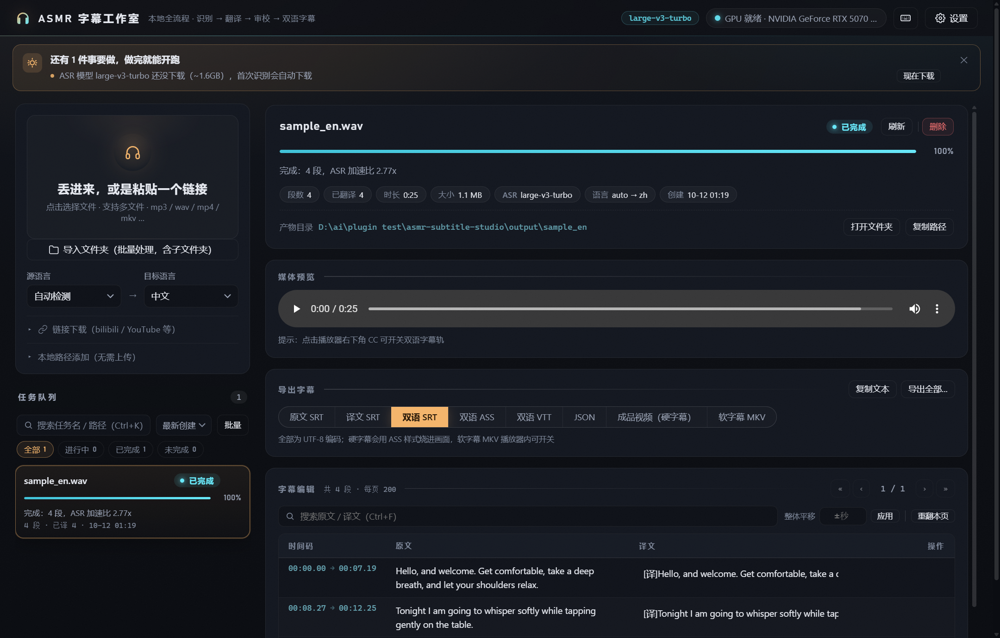

# ASMR 字幕工作室

本地全流程 ASMR 音视频字幕工具：**拖入文件/粘贴链接 → 自动下载（bilibili/YouTube 等）→ ffmpeg 抽音频 → 本地 ASR（whisper.cpp，模型自动从 hf-mirror 下载）→ API 翻译 → API 审校 → 输出双语字幕**。

支持中文 / 英文 / 日文互译，桌面原生窗口（WebView2）：拖拽上传、链接解析下载、实时进度、视频预览挂双语字幕轨、逐句编辑 / 单句重翻、多种格式导出。

## 快速开始

**方式一（推荐）：桌面版单文件 exe（Rust + Tauri v2，`desktop/`）**

```bat
desktop\build-release.bat
```

产物 `desktop\dist\ASMR字幕工作室.exe` 是**真正的单文件**（CPU 版约 89MB，GPU 版约
143MB，均内嵌压缩的 ffmpeg/ffprobe/yt-dlp）：拷到任何 Windows 10/11 x64 电脑双击即用。**无本地 HTTP 服务、
无端口监听**——旧版 `[Errno 13] bind 8765 被拒`（Windows Hyper-V/WinNAT 保留端口段
8740-8839 恰好覆盖 8765）的问题从架构上根除。首次启动自动在 exe 同级展开：

```
程序目录/
  ASMR字幕工作室.exe
  .env               ← LLM API Key（设置页写入，不进 git）
  data/              任务/配置/模型（ggml 格式，从 hf-mirror.com 直连下载）
  output/
    {视频名}/        ← 字幕产物 + 下载的 mp4（同一文件夹，便于直接挂载使用）
  tools/             ffmpeg / ffprobe / yt-dlp（首次启动自动解包，可自行替换升级）
```

- 实时进度/事件走 WebView IPC 通道，视频预览走自定义媒体协议（支持 Range 拖动）
- GPU：默认 CPU 构建（零依赖）；构建机装有 Vulkan SDK 时可
  `cargo build --release -p asmr-studio --features asmr-core/whisper-vulkan`
  出 GPU 版（RTX 等，运行期零额外依赖）；设备 auto 时自动用 GPU，失败回退 CPU
- 与 Python 版数据格式完全互通（tasks/segments/字幕产物同构）

**方式二（旧版）：Python 单文件 exe（PyInstaller，`build_exe.bat`）**

仍保留可用；注意其本地 HTTP 服务可能撞上 Windows 保留端口段（`netsh int ipv4 show
excludedportrange protocol=tcp` 可查），此时换 `--port` 或改用桌面版。

**方式三（开发/源码运行）：**

```bat
start.bat    & :: Python 版：双击（首次自动建 venv 装依赖），访问 http://127.0.0.1:8765
```

桌面版开发：见 `desktop/README.md`（cargo build / e2e 测试 / GPU 构建）。

## 使用流程

1. **设置**（右上角）→「翻译 API」里填你的 OpenAI 兼容接口（默认 DeepSeek：`https://api.deepseek.com/v1` + `deepseek-flash`，也支持 Moonshot/OpenAI/ollama/one-api 等任何兼容端点），保存后点「测试翻译连接」确认。
2. **三种添加方式**：拖入/选择 音视频文件（可多文件）；「本地路径添加」直接引用磁盘上的大文件（不上传复制）；**「链接下载」粘贴 bilibili / YouTube 等平台视频页链接**（yt-dlp 解析，自动下载后接完整流程）。
3. 选好 源语言（默认自动检测）/ 目标语言，任务自动排队执行：下载（URL 任务）→ 抽音频 → 识别 → 翻译 → 审校 → 生成字幕。
4. 点开任务卡片：在线预览（视频可直接挂双语字幕轨播放）、逐句编辑译文、单句「重翻」、导出 **原文/译文/双语 SRT、双语 ASS、双语 VTT、JSON**；详情里有「文件位置」（产物目录 + 一键打开文件夹，下载的视频就在同一目录），失败/取消的任务卡片上直接有「重试」。

## v2.1 易用性增强（桌面版为主）



### 开箱就能用

- **就绪检查条**：启动后自动检查「翻译 API Key / 默认 ASR 模型 / ffmpeg」，缺什么在顶部提示，并给出「去配置 / 启用 Mock / 现在下载」一键入口；点 ✕ 本次运行不再提示。
- **空队列引导**：没有任务时给出「选择文件 / 粘贴链接 / 配置翻译 API」三个入口。
- **没配 Key 的拦截**：添加任务前提醒「会在翻译阶段停下」，可直接跳设置或仍要添加（识别结果已落盘，配好 Key 后在任务卡点「重试」即可续跑）。

### 队列

- 搜索（任务名 / 路径 / 链接）、按状态筛选（全部 / 进行中 / 已完成 / 未完成）、排序（最新创建 / 最近更新 / 名称 / 时长）。
- **批量模式**：勾选多个任务后批量重试 / 取消 / 删除；「全选」只作用于当前筛选结果。
- 任务卡「⋯」菜单：在文件夹中显示、复制产物路径、复制源链接、重新入队、取消、删除。
- 运行中的任务显示**预计剩余时间**；任务超过 100 条时可「加载更多」。

### 字幕编辑

- **搜索**：原文 / 译文即时高亮，Enter / Shift+Enter 跳上 / 下一处，自动翻页定位。
- **键盘导航**：↑↓ 选句、Enter 进入译文编辑、Ctrl+Enter 保存并跳下一句、Ctrl+S 立即保存、Esc 取消。
- **双击原文**即可修正 ASR 识别错误（保存后写入 segments.json 并重写全部字幕产物，可再点该行「重翻」同步译文）。
- **单击时间码**跳到播放位置；播放时自动高亮当前句并跟随翻页。
- **行操作**：与下一句合并、按时间点拆分、复制本句（原文 + 译文）。
- **时间轴整体平移**（±秒，适合整轨错位）；**「重翻本页」**一次重翻当前页（并发受设置里「并发数」约束，默认 3、上限 6）。
- 切换任务 / 翻页前自动保存未提交的译文。

### 导出与设置

- **复制文本**：把双语字幕纯文本复制到剪贴板；**导出全部…**：选一个文件夹，一次写出 6 种字幕文件。
- 成品视频渲染中再点按钮可**取消**渲染。
- 设置里新增**服务商预设**（DeepSeek / Moonshot / OpenAI / Ollama / One API），选完自动填 Base URL 与模型名。
- **复制配置 / 从剪贴板导入**（不含 API Key，方便备份和换机）；**打开数据目录**。
- 模型列表可**删除**已下载模型释放磁盘，并标记当前默认模型。

### 快捷键

`?` 打开快捷键面板；`Ctrl+K` 搜任务；`Ctrl+F` 搜字幕；字幕表内 ↑↓ / Enter 导航；Space 播放 / 暂停、← / → ±2 秒。

## 失败重试与断点续跑

任务失败后点「重试」（卡片或详情里都有），管线会**自动跳过已完成的阶段**：视频已下载→跳过下载、audio.wav 已存在→跳过抽取、识别结果已落盘→跳过识别，直接从失败的阶段继续。典型场景：没配 API Key 时任务会快速失败并明确提示 → 配好 Key 后点重试，几十秒内完成翻译，不用重跑一小时的视频识别。

跳过翻译的策略：只有**手动指定**源语言=目标语言，或自动检测置信度 ≥0.9 且语言相同时才跳过（ASMR 轻声+音乐下语言检测不可靠，宁可多翻一次也不会静默漏翻）；Mock 模式的 `[译]` 前缀伪翻译不会被当作真实译文。

## 链接下载（bilibili / YouTube）

- 基于 yt-dlp，默认下载 **≤720p** 视频并合并为 mp4（画质可在设置里调），仅取音频的平台类型同样支持。
- 设置里有「下载」分组：**代理**（YouTube 等境外平台连不上时填，如 `http://127.0.0.1:7890`）、**浏览器 cookies**（`chrome`/`edge`/`firefox`，用于需要登录/会员的视频）。
- 音乐/MV 类视频若 VAD 把整段音频过滤光导致 0 段，会**自动关闭 VAD 重识别**（设置里 `asr.vad` 可强制 on/off）。
- 歌曲视频曾实测：B 站 MV 下载 → 63/41 段歌词识别全通；下架视频会报 404 等明确错误。

## ASR 模型（从魔搭下载）

首次识别会自动从魔搭（ModelScope）直连下载所选模型到 `data/models/`（纯 HTTP 实现：真实百分比进度、断点续传，无需任何第三方 SDK）。也可在「设置 → ASR 模型下载」里预下载、看进度。

| 模型 | 魔搭仓库 | 体积 | 说明 |
|---|---|---|---|
| small（默认） | gpustack/faster-whisper-small | ~480MB | 快，中英日良好 |
| medium | gpustack/faster-whisper-medium | ~1.5GB | 更准 |
| large-v3 | gpustack/faster-whisper-large-v3（备用 keepitsimple 镜像） | ~3GB | 最准，推荐 GPU |
| large-v3-turbo | pengzhendong/faster-whisper-large-v3-turbo | ~1.6GB | large-v3 加速版，性价比最高 |

GPU：有 NVIDIA 显卡时自动用 CUDA（float16），需要 `nvidia-cublas-cu12` + `nvidia-cudnn-cu12`（requirements 已含，RTX 50 系需 cuBLAS ≥ 12.8）；任何 CUDA 问题自动回退 CPU int8，不会中断任务。

## 配置

所有配置存 `data/config.json`，也可在网页设置里改：ASR 模型/设备、翻译参数（温度/并发/批大小/重试）、术语表（每行 `原文=译文`，强制注入提示词）、审校开关、双语顺序、每行最大字符数等。

- **翻译协议**：逐批（默认 40 句/批）按 `行号|译文` 严格解析，解析不完整自动纠错重试，仍失败按兜底对齐保证句数不变；批间并发可调，带上下文（前 3 句定稿）保持全文一致。
- **审校**：二次 LLM 校对（误译/不通顺/术语不一致/语气），可在设置里关。
- **Mock 模式**：设置里打开后翻译走本地伪翻译，**无 API Key 也能跑通全流程**（测试/演示用）。
- **幻觉标记**：识别结果里疑似 Whisper 幻觉（字幕组致谢、广告词等）的句子会标 ⚠，方便人工复核。

## 目录与密钥

单文件 exe 运行后会在 **exe 所在目录**构建工作目录（源码运行则在项目根目录）：

```
程序所在目录/
  ASMR字幕工作室.exe  （单文件，随意拷贝）
  .env               ← LLM API Key 存这里（LLM_API_KEY=sk-xxx），不进 git、不进 config.json
  data/
    tasks/{id}/      任务工作目录（下载的视频、audio.wav、segments.json）
    models/          魔搭下载的 ASR 模型
  output/
    {视频名}/        每个视频一个独立产物文件夹（orig/trans/bilingual SRT、ASS、VTT、JSON）
```

- 详情页「文件位置」可一键打开产物文件夹；删除任务会连带删除它的产物文件夹。
- API Key 在网页设置里保存后会写入 `.env`；也可手动编辑。仓库里有 `.env.example` 模板。

## 目录结构（源码）

```
run.py              启动入口（exe 与源码共用；自动开窗口、端口占用检测、--port/--browser）
backend/            FastAPI 后端（app.py 路由 / pipeline.py 管线 / tasks.py 任务与 SSE
                    / asr/ 识别与魔搭下载 / translate/ 翻译审校 / downloader.py 链接下载
                    / subtitles.py 字幕输出）
frontend/           单页前端（零依赖、零构建、完全离线；打包时内嵌进 exe）
build_exe.bat       PyInstaller 打包脚本 → dist/asmr-subtitle-studio/
tools/ffmpeg/       内置 ffmpeg（打包时会复制到 dist）
scripts/e2e_test.py 端到端测试（对运行中的服务跑：英文样例→全流程→下载→编辑）
docs/API.md         REST API 契约
```

## 测试

```bash
./.venv/Scripts/python -m backend.tests.test_translate   # 翻译模块单元测试（无需依赖/联网）
./.venv/Scripts/python -m uvicorn backend.app:app --port 8765   # 先起服务
./.venv/Scripts/python scripts/e2e_test.py               # 端到端（自动开 mock 翻译）
```

实测（RTX 5070 Ti Laptop, CUDA float16, small 模型）：25s 英文音频 ASR 1.3s（≈19x 实时），全流程含 mock 翻译约 8s。

## 常见问题

- **首次 GPU 识别偏慢**：新架构显卡（RTX 50 系）首次 CUDA 推理需要一次性内核编译（约 1 分钟，驱动自动缓存），之后恢复满速。实测二跑起 10x+ 实时。
- **双击 exe 后窗口一闪而过**：一般是端口被占用（已有实例在运行）或启动错误，现在的版本控制台会停留显示原因并等回车；也可用 `--port 8766` 换端口。
- **端口占用**：exe 支持 `--port`；检测到本程序实例时优先打开桌面窗口而非浏览器。
- **模型下载慢/失败**：直连魔搭支持断点续传，重试即可；或手动下载仓库内容解压到 `data/models/{模型名}/`。
- **CUDA 报错**：确认驱动 ≥ CUDA 12.8（RTX 50 系）；单文件包会自动下载 GPU 运行库到 `data/cuda/`（仅一次），失败则自动回退 CPU 不中断任务。
